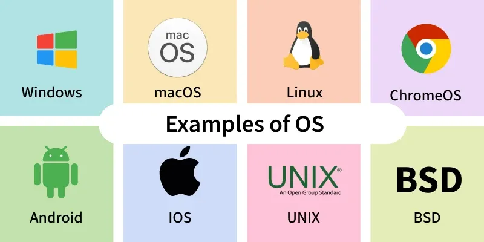
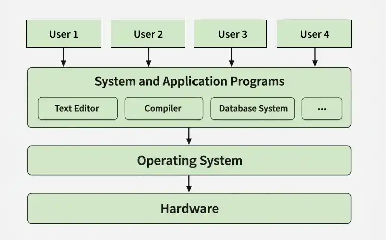
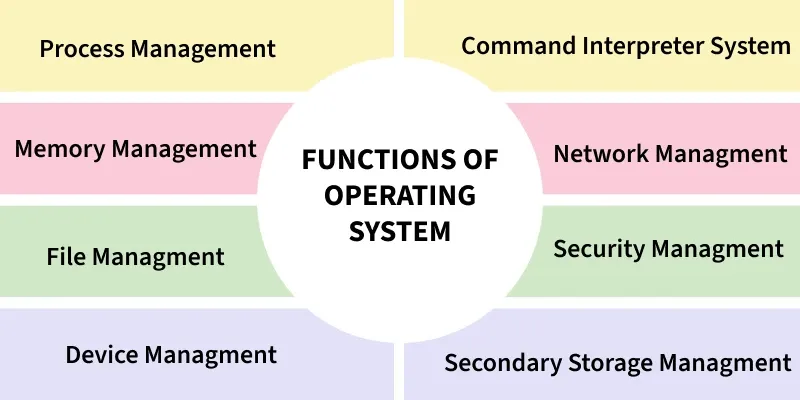
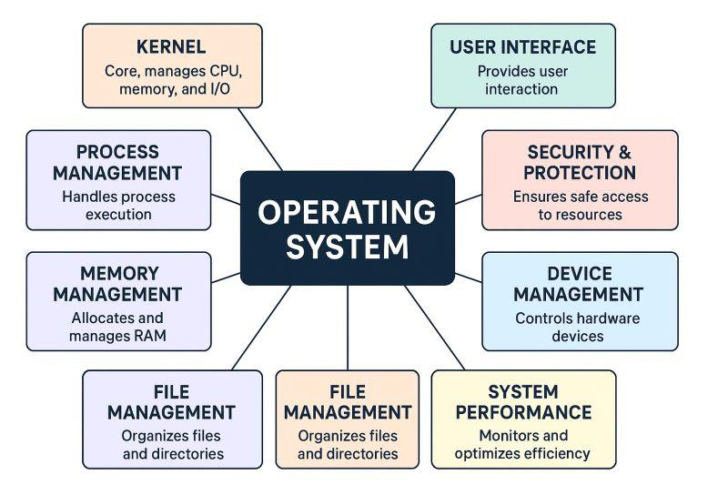

### 1. What is Operating System?
An Operating System (OS) is system software that acts as an interface between the computer and the user or application programs. it manages computer hardware and software resources and provides an environment in which application can run.

In simple words, an Operating System helps users or applications communicate with computer hardware without needing to control the hardware directly.

#### **Examples of Operating Systems**

### 2. Why do we need an Operating System?
Imagine you have a computer with: 
*I. CPU* 
*II. RAM* 
*III. HARD disk/SSD* 
*IV. Keyboard and Mouse* 
*V. Monitor*

without an Operating System, managing these components and running applications would be extremely difficult.

#### For example:
*I. When you open Chrome, the OS allocates memory to it.* 
*II. When you play music, the OS manages audio output.* 
*III. When you save a file, the OS manages storage operations.* 
*IV. When you run multiple applications, the OS manages CPU time.*

without an Operating System we have to manages these resources through our application programs, which makes our application program heavy/bulky and difficult to maintain.

Therefor, an OS makes computer system easier to use and manages their resources efficiently.

#### The communication happens in the following way:

**I. User:** *interacts with the computer.* 
**II. Application Software:** *Programs such as Chrome, VS Code, Compiler, Assembler, Text editor, Databases and games etc.* 
**III. Operating System:** *Manages resources and provides services to applications.* 
**IV. Hardware:** *CPU, RAM, storage devices, keyboard, etc.*

### 3. Main responsibility of an Operating System

**Process Management** 
*Manages running programs and processes.*

**Memory Management** 
*Allocates and deallocates RAM.*

**File Management* *
*Organizes and manages files and directories.*

**Device Management** 
*Controls hardware devices through drivers.*

**CPU Scheduling** 
*Decides which process gets CPU time.*

**Security & Protection** 
*Protects system resources and user data.*

**I/O Management** 
*Manages input and output operations.*

### 4. Types of Operating System
1. Batch OS 
2. Multi-Programming OS 
3. Time sharing OS 
4. Multi-User OS 
5. Real Time OS 
6. Multi-Processing OS 
7. Network OS 
8. Multi-Tasking OS 
9. Distrubuted OS 
10. Embedded OS
11. Mobile OS 

### 5. Goals of Operating System(OS)

**1. Convenience** 
*I. Make computers easier for users to operate.* 
*II. Provide a simple interface between users and hardware.* 
*III. Allow users to run applications without understanding hardware details.*

**2. Efficiency** 
*I. Utilize computer resource efficiently.* 
*II. Manage CPU, RAM, storage, and I/O devices.* 
*III. Minimize resource wastage and improve system performance.*

**Example:** CPU scheduling allows multiple processes to share CPU time efficiently.

**3. Resource Management** 
*I. Manage and distribute system resources among different programs.* 
*II. Allocate and deallocate memory when required.* 
*III. Coordinate access to hardware devices.*

**Example:** When multiple applications are running, the OS manages their CPU and memory requirements.

**4. Reliability and stability** 
*I. Ensure the system operates correctly and consistently.* 
*II. Handle errors and prevent application failures from affecting the entire system.*

**Example:** if one application crashes, the OS should prevent it from unnecessary crashing the entire computer.

**5. Security and Protection:** 
*I. Protect system resources and user data from unauthorized access.* 
*II. Provide authentication and access control.* 
*III. Isolate processes to prevent unwanted interference.*

**Example:** A user account password prevent unauthorized users from accessing your computer.

**6. Ability to Evolve** 
*I. Support new hardware and technologies.* 
*II. Allow new features and functionalities to be added.* 
*III. Adapt to changing user requirements.*

**Example:** An OS can support new processors, storage devices, and hardware drivers through updates.

### 6. Components of an Operating System
An Operating System consists of several components that work together to manage computer hardware, software resources, and provide service to users and applications.

Each component has a specific responsibility.

**1. Kernal** 
The Kernal is the core component of an Operating System. it acts as a bridge between software and hardware.

**Responsibilities:** 
*Manages CPU and processes.* 
*Manages memory.* 
*Handles hardware communication.* 
*Managees system calls.* 
*Controls access to syistem resources.*

**Example:** When an application needs CPU time or memory, the kernal manages the requests.

**2. Process Management** 
Process Management handles the creation, execution, scheduling, and termination of processes.

**Responsibilities:**
*Create and terminate processes.* 
*Schedule process states.* 
*Manage process states.* 
*Handle process synchronization.* 
*Support inter-process communication (IPC).*

**Example:** Running chrome, VS Code, and a music player simultaneously.

**3. Memory Management** 
Memory Management manages the computer's main memory (RAM).

**Responsibilities:** 
*Allocate memory to processes.* 
*Dallocate memory when it is no longer needed.* 
*Track memory usage.* 
*Manage virtual memory.* 
*Protect the memory space of processes.*

**Example:** When you open VS Code, the OS allocates RAM for its execution.

**4. File System Management** 
File System Management organizes, stores, retrieves, and manages files and directories.

**Responsibilities:** 
*Create and delete files.* 
*Create and manage directories.* 
*Read and write files.* 
*Manage file permissions.* 
*Organize data on storage devices.*

**Example:** Creating a folder, saving a document, or deleting a file.

**5. I/O (Input/Output) Management** 
I/O Management controls and coordinates communication between the computer and input/output devices.

**Responsibilities:** 
*Manage input and output devices.* 
*Coordinate device communication.* 
*Handle I/O requests.* 
*Manage buffering, caching, and spooling.* 
*Work with device drivers.*

*Example:* Reading input from a keyboard or displaying output on a monitor.

**6. Secondary Storage Management** 
This component manages data stored on secondary storage devices such as HDDs and SSDs.

**Responsibilities:** 
*Manage free storage space.* 
*Allocate storage space.* 
*Manage disk scheduling.* 
*Organize data storage.*

**Example:** Saving a video or installing software on an SSD.

**7. Security and Protection** 
This component protects the computer system and its resources against unauthorized access.

**Responsibilities:** 
*User authentication.* 
*Access control.* 
*Process isolation.* 
*File permissions.* 
*Protection of system resources.*

**Example:** Requiring a password to log in to you computer.

**8. Networking Management** 
Networking management handles communication between computers and network devices.

**Responsibilities:** 
*Manage network connections.* 
*Support communication between systems.* 
*Manage network resources.* 
*Provide networking protocols and services.*

**Example:** Connecting your computer to the internet through Wi-Fi.

**9. Command Interpreter / User Interface** 
It provides a way for users to interact with the Operating System.

There are two common types:

**1. CLI (Command-Line Interface):** *Users interacting using text commands.* 
**2. GUI (Graphical User Interface):** *Users interact using windows, icons, menus, and pointers.*

**Example:** 
CLI: *Linux Terminal, Windows Command Prompt.* 
GUI: *Windows Desktop, Ubuntu Desktop.*

### Important notes:

**Operating System (OS)** 
*An Operating System is system software that acts as an interface between the user, applications, and computer hardware.*

**Examples:** Windows, Linux, macOS, Android, IOs

**System Software** 
*System Software is a collection of programs that manages computer hardware and provides a platform for running application software.*

*It helps the computer operate and allows other software to interact with hardware.*

**Examples:**

*I. Operating Systems: Windows, Linux etc.* 
*II. Device Drivers: Printer driver, graphics driver* 
*III. Language Translators: compiler, intepreter, Assembler* 
*IV. Utility Programs: Disk Cleanup, Antivirus System Libraries: Standard C Library*

**Application Software** 
*Application Software is a program or collection of program designed to help users perform specific tasks.* 
*it runs on top of system software and uses the services provided by the operating system.*

**Examples:**

*I. Text Editing: MS Word, Notepad* 
*II. Web Browsing: Chrome, Firefor* 
*III. Image Editing: Photoshop, GIMP* 
*IV. Programming: VS Code, PyCharm* 
*V. Entertainment: VLC, Games* 
*VI. Communication: WhatsApp, Telegram*

**Main responsibilities:** 
*I. Performs specific user tasks.* 
*II. Provides a user-friendly interface.* 
*III. Uses OS service to access hardware and system resources.*