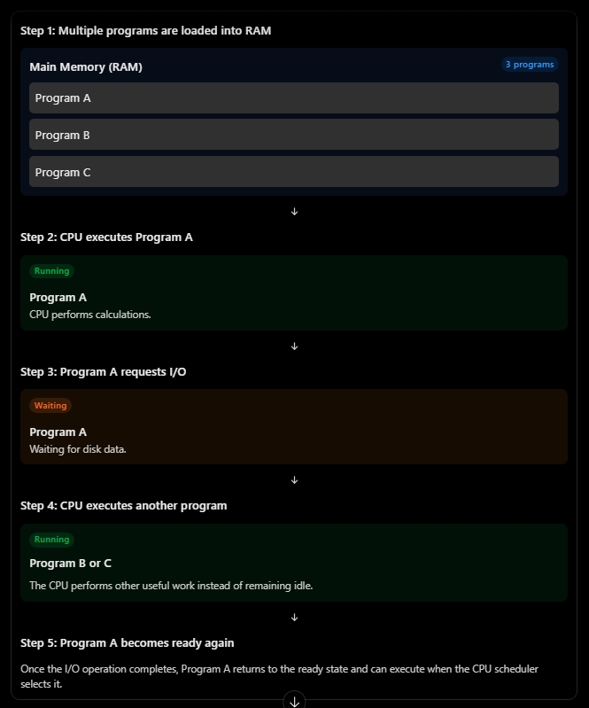

### Multi-Programming Operating System

A Multiprogramming Operating System is an operating system that keeps multiple programs in main memory (RAM) at the same time and switches the CPU between them to maximize CPU utilization.

In simple words, when one program is waiting for an I/O operation (such as reading a file), the OS assigns the CPU to another program instead of keeping the CPU idle.

Examples:

- IBM OS/360
- OS/360 MVT (Multiprogramming with a variable number of Tasks)
- Modern Linux and Windows system also support multiprogramming.

### Why was multiprogramming OS introduce?

Let's understand the problem with an earlier system.

Suppose a computer is executing only one program.

- Program 'A' needs the CPU to perform calculations.
- After some calculations, Program 'A' requests data from a hard disk.
- The CPU must wait while the disk provides the data.
- During this waiting period, the CPU remains idle if no other work is available.

**Solution:** Keep multiple programs in RAM. When one program waits for I/O, the CPU executes another ready program.

### How does Multiprogramming OS work?

Suppose three programs are loaded into RAM:

- Program A: Performing calculations.
- Program B: Reading data from a disk.
- Program C: Performing mathematical operations.

The execution works like this:

This Process continues until all programs finish execution.

### Characterstics of Multiprogramming OS

**I. Multiple Programs in RAM:** Keeps several programs in main memory simultaneously. 
**II. CPU Scheduling:** Selects which ready program should execute next. 
**III. I/O Management:** Allows CPU execution to continue while another program performs I/O. 
**IV. Automatic Switching:** The OS switches execution between programs based on their states and scheduling decisions.

### Advantages

- Improves CPU utilization.
- Reduces CPU idle time.
- Increase system throughput.
- Allows multiple programs to remain in memory.
- Makes better use of computer resources.

### Disadvantages

- Require complex memory management.
- Require CPU scheduling.
- Memory protection becomes important.
- More complex OS design.
- Performance can decrease if RAM is insufficient.

### Multiprogramming vs Time-Sharing OS

#### Multiprogramming OS

- Focuses on CPU utilization.
- CPU switches when a program waits, commonly for I/O.
- Mainly designed to execute multiple jobs efficiently.
- User interaction is not its primary goal.

#### Time-Sharing OS

- Focuses on quick response and interaction.
- CPU switches after a time slice expires or other scheduling events.
- Designed to let multiple users/processes interact with the system.
- User interaction is a major goal.