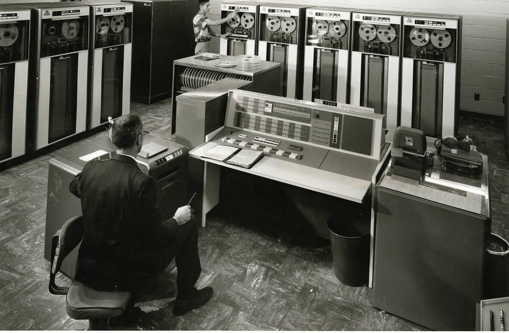
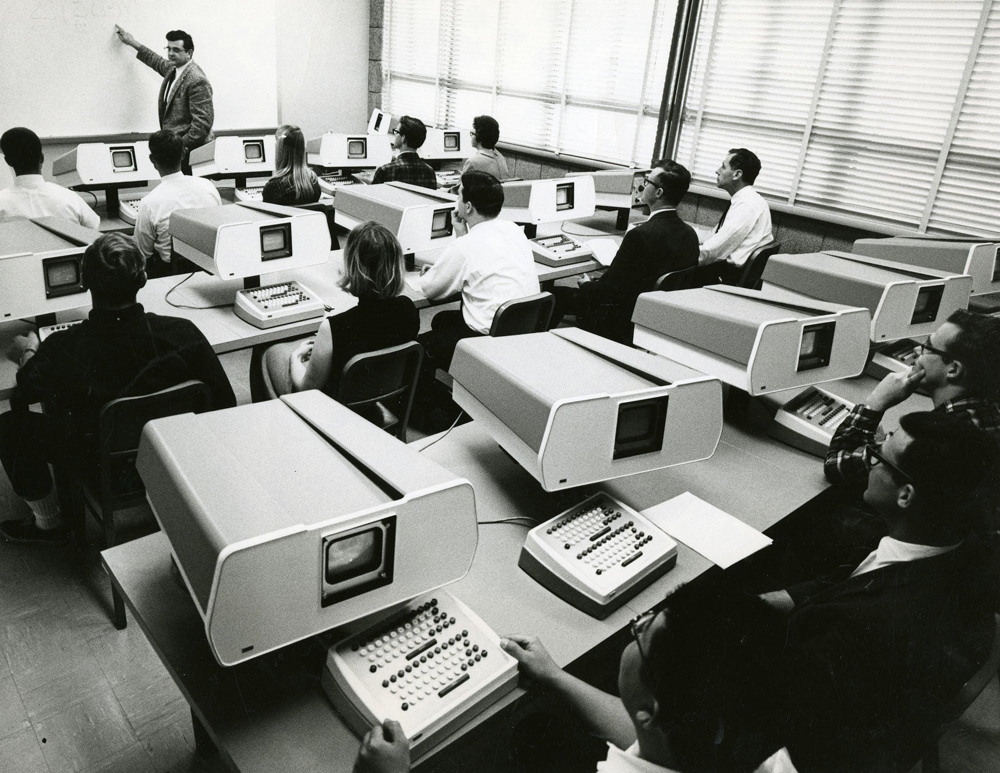

### Time-Sharign Operating System

A Time-Sharing Operating System is an operating system that allows multiple users or processes to share CPU time simultaneously by allocating a small amount of CPU time to each processes.

In simple words, the CPU switches rapidly between multiple processes, giving each process a chance to execute. This makes it appear that all processes are running at the same time.

### How does Time-Sharing OS work?

Let's understand with an example. 
Suppose three users are working on the same computer system: 
*User A is editing a document.* 
*User B is running a program.* 
*User C is browsing files.*

The CPU gives each process a small amount of time called a Time Slice (Time Quantum).

### Important terminology

**1. Time Slice (Time Quantum)** 
*I. A fixed amount of CPU time allocated to a process.* 
*For example, 10 miliseconds.*

**2. Context Switching** 
*The process of saving the state of the currently running process and loading the state of another process.* 
*Allows the CPU to switch between processes.*

**3. CPU Scheduling** 
*I. Decides which process gets CPU time next.* 
*II. Round Robin scheduling is commonly associated with time-sharing systems.*

### Charaterstics of Time-Sharing OS**

***I. Multiple Users:*** *Supports multiple users accessing the system.* 
***II. Time Silicing:*** *CPU time is divided into small intervals.* 
***III. Quick Response:*** *Provides quick responses to user requests.* 
***IV. Context Switching:*** *Switches between processes frequently.* 
***V. Resource Sharing:*** *Multiple users share CPU, memory, and other resources.* 
***VI. Interactive Environment:*** *Users can interact with the system while program are executing.*

### Advantages

*I. Supports multiple users simultaneously.* 
*II. Provides quick response times.* 
*III. Improve CPU utilization.* 
*IV. Allows interactive computing.* 
*v. Shares sytem resources efficiently.*

### Disadvantages

*I. Context switching introduces overhead.* 
*II. Requiring proper CPU scheduling.* 
*III. Security and privacy become more challenging with multiple users.* 
*IV. System performance may decrease when too many users are active.* 
*V. Requires memory and resource management.*

### Why Time-Sharing OS developed, if we already had Bacth OS?

The main problem with Batch OS was that users had to wait for their jobs to finish without interacting with the computer during execution. Time-Sharing OS was developed to overcome this limitation and provide interactive computing.

Let's understand the evolution.

#### 1. Problem with Batch Operating System

Imagine you are a programmer working on a university computer. 
You wite a program and submit it to the computer for execution. 
Suppose your program contains an errro. 

In a Batch OS:

*I. You submit your program.* 
*II. Your program waits in a job queue.* 
*III. The computer executes your program.* 
*IV. It discovers an error.* 
*V. You receive the output showing the error.* 
*VI. You correct the program and submit it again.*

The Problem: *You cannot interact with the program while it is executing. You may have to wait a long time just to discover a small error.*

#### 2. Why was Time-Sharing OS introduced?

To solve these problems:

*I. Users wanted immediate response.* 
*II. Users wanted to interact with program during execution.* 
*III. Multiple users wanted to use the same computer system.* 
*IV. Waiting for an entire batch to finish was inefficient for interactive tasks.*

Time-Sharing OS addressed these requirements by dividing CPU time into small time slices and sharing it among multiple users or processes.

