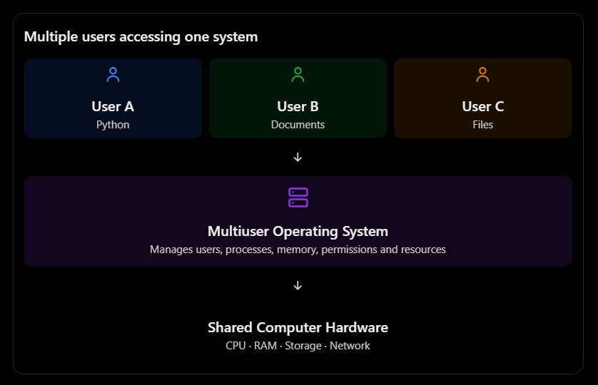

### Multiuser Operating System

A Multiuser Operating System is an operating system that allows multiple users to access and use the same computer system and its resources simultaneously.

Im simple words, multiple users can work on one computer system at the same time, each using their own account and environment.

Example:

**Unix** - Multiuser computing environments 
**Linux** - Srvers and remote user access 
**Windows Server** - Centralized user and resource management 
**IBMz/OS** - Enterprise mainframe computing

### Why was Multiuser OS introduced?

Imagine a university has one powerful central computer.

There are 100 students who need to use it for:
- Programming.
- Running applications.
- Accessing files.
- Performing calculations.

Instead of purchasing 100 separate computers, the university can allow students to access the same centeral computer through different terminals.

Each student can log in using their own username and password.

The operating system manages their access and resources.

### How does Multiuser OS work?

Suppose three users access the same computer:
- User A: Running a Python program.
- User B: Editing a document.
- User C: Accessing files.

The OS manages their sessions, process, memory, and permissions.

### What does the OS manage?

**1. User Management:** Maintains separate user accounts. 
**2. Authentication:** Verifies usernames and passwords. 
**3. Memory Management:** Allocates memory to different user's processes. 
**4. Process Management:** Manages processes belonging to different users. 
**5. File Permissions:** Controls which users can access or modify files. 
**6. Resource Sharing:** Allows multiple users to share hardware resources.

### Characterstics of Multiuser OS
- Supports multiple user accounts.
- Allows simultaneous access by multiple users.
- Provides user authentication.
- Maintains separate user environments.
- Provides file and resource permissions.
- Manages resources among different users.

### Advantages
- Multiple users can share one powerful computer.
- Reduces hardware and maintenance costs.
- Provides centralized resource management.
- Supports collaboration and file sharing.
- Provides separate user accounts and permissions.

### Disadvantages
- Require strong security and access control.
- Heavy usage by multiple users can reduce performance.
- System failure can affect all connected users.
- Requires proper resource allocation.
- Administration can become complex.

### Multiuser OS vs Multitasking OS

These two concepts are often confused.

#### Multiuser OS
- Supports multiple users.
- Focuses on managing multiple user accounts and sessions.
- Manages user permissions and resources.
- Example: UNIX

#### Multitasking OS

- Supports multiple tasks.
- Focuses on executing multiple tasks.
- Manages CPU time and task execution.
- Example: Windows

***Important:*** *A single OS can support both multiuser and multitasking features. For example, Linux allows multiple users to log in while each user can run multiple applications.*

