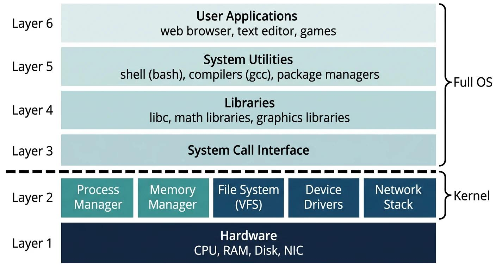

### Kernal in Operating System

A kernel is the core part of an Operating System that manages the computer's hardware and software resources.

It act as a bridge between application software and computer hardware.

In simple words, the kernal helps software communicate with hardware and manages all the important operations of a computer.

### Why do we need a Kernel?
A computer has several hardware components, such as:
- CPU
- RAM
- Hard Disk / SSD
- Keyboard
- Mouse
- Network Interface Card (NIC)

Application need these resources to perform operations. However, application should not directly control hardware because it can cause security problems and resource conflicts.

Therefore, the kernel manages access to hardware and provides a controlled way for applications to use system resources.

### Main Function of a Kernel

The Kernel performs several important functions:

#### 1. Process Management
- Creates and terminates processes.
- Schedules processes for CPU execution.
- Handles process synchronization and communication.

#### 2. Memory Management
- Allocates and deallocates memory.
- Manages RAM usage.
- Handles virtual memory.

#### 3. Device Management
- Controls hardware devices through device drivers.
- Manages communication between hardware and software.

#### 4. File System Management
- Provides interface for accessing files.
- Manages file-related operations through the OS.

#### 5. CPU Scheduling
- Decides which process gets CPU time.
- Helps multiple processes share CPU resources.

#### 6. Security and Protection
- Controls access to hardware and system resources.
- Prevents unauthorized access between processes.

#### 7. System Call Handling
- Provides an interface through which application request services from the kernal.

### If kernal manages resources then what does OS do?

This is where many students get confused because the Kernal and Operating System (OS) performs closely related responsibilities.

The important thing to understand it:

The Kernal is a core component of the Operating System. It is not separate from the OS.

#### What does the Operating System do?

An Operating System (OS) is system software that manages the entire computer system and provides an environment in which users and applications can work.

It performs tasks such as:
- Managing processes and programs.
- Managing memory.
- Managing files and directories.
- Managing hardware devices.
- Providing a user interface (GUI or CLI).
- Providing security and access control.
- Providing networking services.
- Providing system utilities and services.

#### Then what does the Kernel do?

The kernel is the central component of the OS that handles the low-level management of hardware and system resources.

For example:

- **Process Management:** Schedules processes and manages their execution
- **Memory Management:** Allocates and manage memory
- **Device Management:** Communicates with hardware through drivers
- **CPU Management:** Controls CPU scheduling
- **System Calls:** Handles requests from applications.

Example: 
1. You click the chrome icon. 
2. The OS provides the environment and services required to lunch chrome. 
3. The kernel allocates memory and schedules CPU time for chrome. 
4. The kernel communicates with hardware when required. 
5. chrome starts running, and you can browse the internet.

*Notice that the OS provides the overall environment, while the kernel handles the core resource-management operations.*

Operating System = Kernel + System Libraries + System Utilities + System Services + User Interface (among other components).

- **OS:** Manages the overall computer system.
- **Kernel:** Performs the core operations required to manage hardware and system resources.

### Types of Kernel

A kernel is the core component of an operating system responsible for managing hardware resources and providing essential services to software.

Kernels can be classified into different types based on their architecture and how they manages system resources.

1. Monolithic kernel 
2. Microkernel 
3. Hybrid Kernel 
4. Modular Kernel 
5. Exokernel