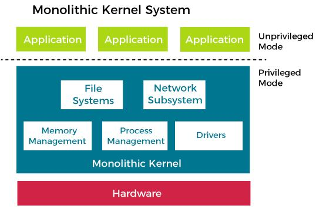
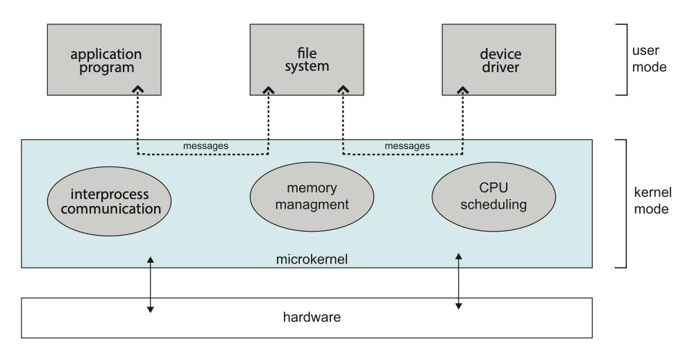
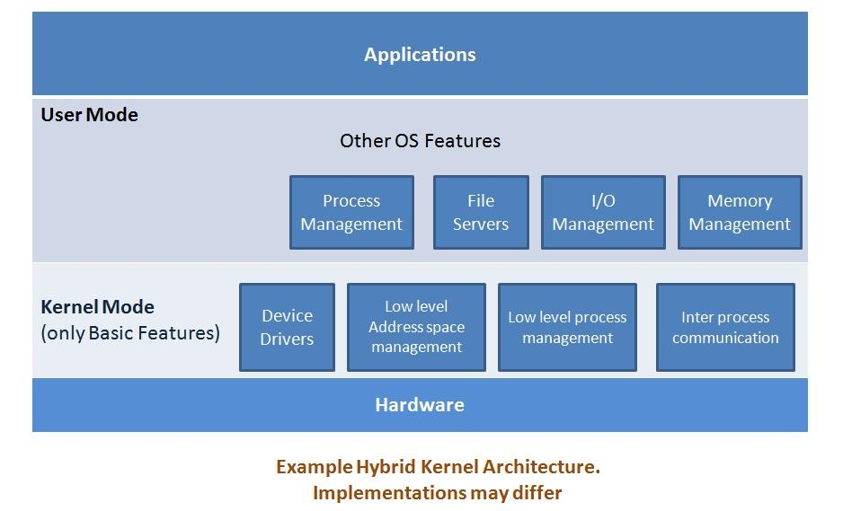
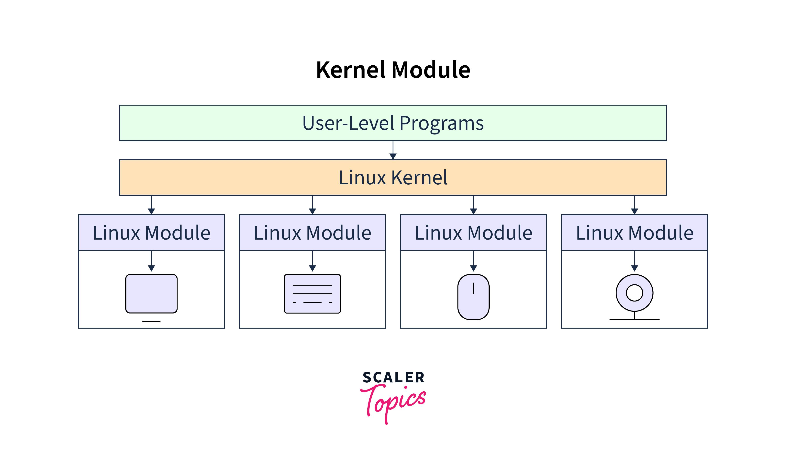
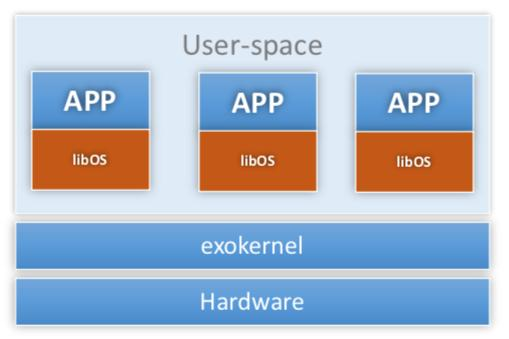
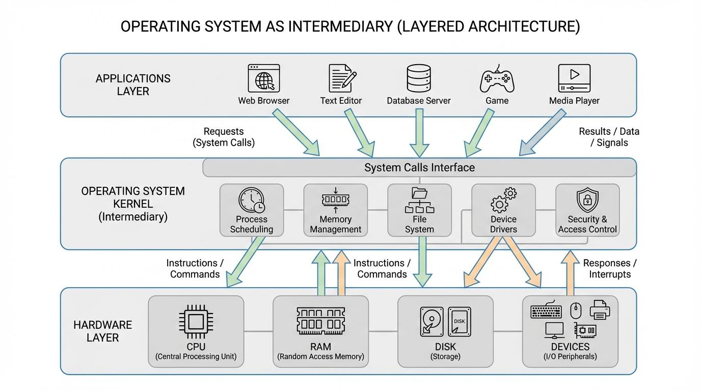
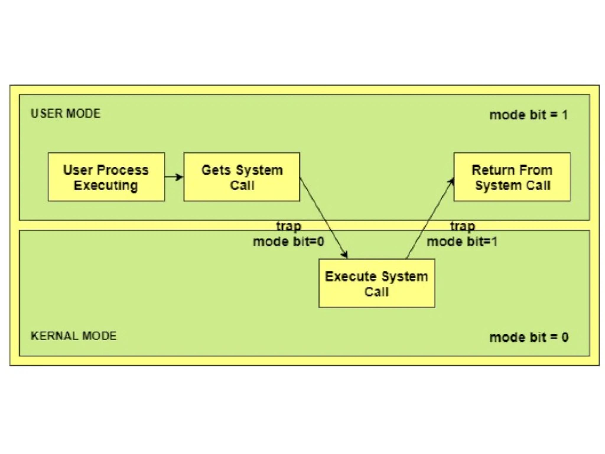

## Types of Kernel in Operating System

### 1. Monolithic Kernel

A Monolithic Kernel is a kernel architecture in which most operating system services run together in kernel space.

These services include:
- Process management
- Memory management
- File system management
- Device drivers
- Network management

#### How it works:

All these components operate within the same privieged kernel space and can communicate directly with one another.



#### Advantages:
- High performance
- Fast communication between kernel components.
- Direct access to system resources.

#### Disadvantages:
- A failure in one kernel component can crash the entire system.
- Large and complex kernel code.
- Difficult to maintain and debug.

Example: Linux, traditional UNIX.

<hr>

### 2. Microkernel

A Microkernel is a kernel architecture that keeps only the essential functions inside the kernel. Other operating system services run in user space.

Essential kernel functions generally include:
- Basic memory management.
- CPU scheduling.
- Inter-process communication (IPC).
- Basic thread management.

Other services, such as file systems and many device drivers, can run outside the kernel.



#### Advantages:
- Better isolation between services.
- Improved fault isolation.
- Smaller kernel, making it easier to maintain.

#### Disadvantages:
- Communication between services can introduce overhead.
- More complex communication architecture.

Examples: MINIX 3, QNX.

<hr>

### 3. Hybrid Kernel

A Hybrid Kernel combines design ideas from monolithic and microkernel architectures.

It aims to acheive good performance while maintaining some modularity and isolation.

Some services that might run in user space in a microkernel are kept in kernel space in a hybrid design.



#### Advantages:
- Good performance.
- Flexible architecture.
- Supports modular components.

#### Disadvantages:
- More complex architecture.
- Some kernel-space failures can still crash the system.

Example: Microsoft Windows NT family, macOS (XNU Kernal).

### 4. Modular Kernel

A Modular Kernel uses independently loadable components called kernel modules.

These modules can extend kernel functionality without rebuilding the entire kernel.

For example:
- Device drivers
- File system modules.
- Network protocol modules



#### Advantages:
- Flexible and extensible.
- Modules can be loaded or unloaded when needed.
- Easier to add hardware support.

#### Disadvantages:
- Faulty modues can cause kernel crashes.
- Module dependencies can make management complicated.

Example: Linux Kernel.

<hr>

### 5. Exokernel

An Exokernel is a minimal kernel architecture that provides applications with more direct and controlled access to hardware resources.

Instead of providing many high-level abstractions, it securely allocates and protects hardware resources.



#### Advantages:
- Greater application-level control over hardware.
- Flexibility.
- Potential for high performance.

#### Disadvantages:
- Application need more responsibility for resource management.
- More difficult to develop applications.

Example: MIT Exokernel (XoK)

<hr>

### Working of kernel in OS

The kernel is the core componet of an Operating System (OS). It acts as an intermediary between application and computer hardware.

Its main job is to receive request from application, manage system resources, communicate with hardware, and return the results.

#### Basic Architecture of Kernel

The computer system can be understood using three main layers:



**1. User Space:** Where applications such ar chrome, vs code and games run.<br>
**2. Kernel Space:** Where the kernel performs privileged(kernel mode's) operations and manages system resources.<br>
**3. Hardware:** Physical components such as CPU, RAM, SSD, Keyboard and mouse.

#### Stemp-by-Stemp Working of kernel

Let's understand the working using an example.

Suppose you open a text editor and save a file.

**1. Application makes a request**<br>
*You click the save button in your text editor. The application needs to write data to storage.*

**2. System Call**<br>
*The application requests the OS to perform a file operation using a system call, such as ```write()```.*

**3. Kernel receives the request**<br>
*The CPU switches from user mode to kernel mode, allowing the kernel to perform privileged(resource management) operations.*

**4. Kernel checks and manages resources**<br>
*The kernel checks permissions, handles the file-system operation and coordinates the required resources.*

**5. Hardware interaction**<br>
*The kernel and appropriate device drivers communicate with the storage device to write the data.*

**Result returned**<br>
*The kernel returns the result of the operation to the application.*

Operation completed

The file is saved, and the application can inform you that the operation was succesful.

<hr>

### Important Mechanism Through Which Kernel Works

The kernel performs its operations using several important mechanisms.

#### I. System Calls

System calls provide a controlled interface through which application request services from the kernel.

Example:

- ```open()``` : Opens a file
- ```read()``` : Reads data
- ```write()``` : Writes data
- ```clsoe()``` : closes a file
- ```fork()``` : Creates a new process (Unix-like systems)
- ```exec()``` : Replaces a process image with a new program

#### II. Mode Switching

Modern operating sytems generally use two execution modes:

##### 1. User MOde
- Applications run with restricted privileges.
- Cannot directly execute privileged instructions.
- Must request privileged services through the OS.

##### 2. Kernel Mode
- Kernel code runs with privileged access.
- Can executes privileged instructions.
- Can manage hardware and system resources.



When an application makes a system call, the CPU transitions from user mode to kernel mode. After the operation, it returns to user mode.

#### III. Interrupt Handling

An interrupt is a signal that requires the CPU's attention.

For example:
- You press a keyboard key.
- A network card receives data.
- A hardware device completes an operation.

The kernel handles the interrupt and performs the appropriate action.

#### IV. Resource Management

The kernel manages important system resources.

CPU: Schedules processes and threads<br>
RAM: Allocates and manages memory<br>
Storage: Coordinates file and storage operaions<br>
I/O Devices: Manages device communication<br>
Processes: Creates, terminates and manages processes